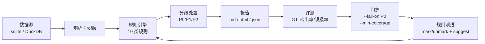

# dq-sentinel 面试材料

> 用于数据质量 / 大数据开发 / 测试开发类岗位。原则：只讲自己真做过的，指标都能在仓库里复现。

## 一、30 秒版本

“我做了一个数据质量巡检的 Agent Skill：把‘入仓前人工抽查’变成规则引擎 + 评测 + 门禁的流水线。
26 条规则覆盖 10 类检查，3 张业务表注入 20 类脏数据后，检出率 100%、误报率 0%；
支持 sqlite 和 DuckDB 双后端，能接 CI 做 P0 阻断和覆盖率门禁；还用 LLM 生成候选规则，
但发现它会照着脏数据生成枚举、把数据分布当业务边界，所以加了结构校验和人工评审两道闸门。”

## 二、3 分钟版本

### 1. 背景（20 秒）

数据入仓和报表产出前，质量检查通常靠人工抽查：漏报说不清、误报没人管、复盘完就忘。
我想验证一件事：能不能把“发现问题”做成一条可重复、可度量、可门禁的流水线。

### 2. 做法（40 秒）

架构是：**接入 → 剖析 → 规则设计 → 巡检 → 分级处置 → 修复回归 → 评测 → 门禁 → 演进**。

- 规则引擎支持 10 种类型：非空、唯一、范围、正则、枚举、外键、新鲜度、自定义 SQL、整行重复、空值率
- 每条规则有 severity（P0/P1/P2）和 design_basis（为什么这么定）
- 巡检输出 md / html / json 三份报告，rowid 级定位
- 评测用 ground truth 算检出率和误报率
- 误报可以 `mark` 标注，下轮自动抑制，但在报告里单列“已抑制”，不掩盖代价

### 3. 结果（40 秒）

- 3 张表（用户/商品/订单）、20 类脏数据、26 条规则
- 38 个问题行全部命中：检出率 100%、误报率 0%
- 关键字段覆盖率 17/17
- 双后端（sqlite / DuckDB）指标一致
- 8 条测试 + GitHub Actions 绿

### 4. 两个真实发现（40 秒）

**发现一：抑制误报是有代价的。**
把一条问题行标成误报后，检出率从 100% 掉到 95.7%——所以误报治理不是“把告警关掉”，
而是要有标注、有记录、有复盘。

**发现二：LLM 生成规则会踩三个坑。**
1. 照着脏数据抄枚举，把 `火星`、`未知` 写进白名单，反而检不出问题
2. 把数据分布当业务边界，`qty [0,6]` 会把合理的大额订单判违规
3. 语义错配，给 `signup_date` 生成“7 天新鲜度”，194/202 个用户会被误报

所以我做了两件事：结构校验（类型/表/列/参数）拦掉非法规则，语义评审交给人和业务字典。
**LLM 只做候选，不做入库。**

### 5. 收尾（20 秒）

这个项目让我把测试里的“误报/漏报”方法迁移到了数据质量：
先定义口径，再建评测集，最后用指标说话。这也是我认为数据治理最缺的能力。

## 三、架构图

## 四、高频追问与参考答案

**Q1：为什么不用 Great Expectations / Soda？**
GE 功能全，但 DSL 重、接入成本高，适合已经有数据平台团队的场景。
我这里是轻量、可嵌入 agent 的实现，重点是“评测 + 门禁 + 误报闭环”，不是替代 GE。
如果生产落地，我会先评估 GE 的 suite 管理能力，再决定自研还是采购。

**Q2：规则引擎和 LLM 怎么分工？**
结构化的（主键、外键、时间、数值范围、枚举）交给规则引擎，确定性强、可解释；
“业务常识”类（手机号唯一、价格非负、未来时间戳）让 LLM 提候选，人评审后入库。
LLM 的输出必须过结构校验，且默认不入库。

**Q3：误报率怎么降？**
三层：规则层（阈值/白名单/表达式）、流程层（mark 标注 + 原因记录）、评测层（按问题类型统计漏报）。
关键是不把“抑制”当成“修复”——报告里会单列已抑制数量。

**Q4：评测可信吗？**
用注入法建 ground truth：每条脏数据记录 `(表, rowid, 问题类型)`，按行算 TP/FP/FN。
局限是演示数据规模小，真实场景需要抽样人工复核，并持续维护评测集。

**Q5：数据量大了怎么办？**
当前是演示规模，规则检查以 Python 遍历为主；真实落地要做三件事：
SQL 下推（只取违规行）、分区裁剪、大表采样剖析。
DuckDB 后端已经验证了 SQL 兼容性，换 Spark/Hive 主要是改连接层和函数适配。

**Q6：实时场景支持吗？**
当前是 T+1 批处理。实时质量需要流式规则（Flink/Spark Streaming）+ 窗口聚合，
指标口径也要改成“分钟级延迟/一致性”，这是另一套设计，我没做过，不冒充。

**Q7：怎么接生产？**
表清单 + 负责人登记 → 规则 PR 评审 → 调度每日巡检 → 告警到 IM → P0 阻断发布 → 周报。
门禁用 `init --clean` 的干净基线，避免演示脏数据误伤。

**Q8：LLM 幻觉怎么防？**
结构校验（类型/表/列/参数）+ 人工语义评审 + 业务字典比对。
实测 LLM 三处错误（枚举污染、分布当边界、语义错配）都写进了对比报告，作为评审清单。

**Q9：覆盖率怎么定义？**
关键字段 = 主键、外键、时间、电话/邮箱、数值、低基数文本；
覆盖率 = 被至少一条规则覆盖的关键字段 / 关键字段总数。
表达式规则会解析 SQL 里引用的列，避免“写了规则但没覆盖字段”。

**Q10：这个项目和测试有什么关系？**
同一套方法：先定义指标口径（误报率/召回率），再建评测集，最后用数据验证修复效果。
我在漏洞哨兵项目里做过一次（37.5% → 0%），在数据质量上又做了一次。

**Q11：你具体负责什么？**
独立完成：需求拆解、规则设计、引擎实现、评测集构造、CI 门禁、文档。
开发过程用 AI 辅助编码，我负责设计决策、测试验证和误报归因。

**Q12：最大的难点？**
口径。比如“金额一致”用下单时单价还是当前价？用当前价会把历史订单全判违规。
这类问题没有标准答案，必须和业务确认，并写进 design_basis。

**Q13：如果重做一次？**
先建评测集，再写规则。我第一版是先写规则后补 ground truth，导致中间调了几次数值。

**Q14：不会 Spark 怎么办？**（诚实版）
“Spark 我只到能写 SQL/DataFrame 的程度，没做过集群调优。
这个项目里我用 DuckDB 验证了 SQL 下推的思路，Spark 的适配层还没做——
如果岗位需要，我可以在入职前把 Spark SQL 和分区裁剪补上。”

**Q15：为什么做这个项目？**
我发现自己擅长“把模糊的问题变成可度量的指标”，数据质量和测试是同一类问题；
而且它能把我的 Python/SQL、评测方法、AI 工具使用串起来。

## 五、反问面试官

1. 团队现在数据质量的主要问题是“发现不了”还是“发现了没人修”？
2. 质量门禁是卡在发布前，还是事后巡检？
3. 规则/指标的口径由谁定义，业务方参与度如何？
4. 团队怎么衡量数据治理的收益？
5. 新人前三个月最需要补的能力是什么？

## 六、简历条目（三行版）

> **数据质量哨兵 · Agent Skill（个人项目）**
> - 用 Python + SQL 实现 10 类质量检查（非空/唯一/范围/枚举/外键/新鲜度/一致性/整行重复/空值率），26 条规则覆盖 3 张业务表 17/17 关键字段
> - 注入 20 类脏数据构建 ground truth，检出率 100%、误报率 0%；支持误报标注与抑制，并量化抑制对召回的影响（100% → 95.7%）
> - 支持 sqlite/DuckDB 双后端与 CI 门禁（P0 阻断 + 覆盖率阈值）；用 LLM 生成候选规则并设计结构校验 + 人工评审流程

## 七、演示顺序（现场 5 分钟）

1. `python scripts/dq.py demo` —— 看指标
2. 打开 `reports/latest.html` —— 看卡片和趋势
3. `python scripts/dq.py check --fail-on P0` —— 演示门禁失败
4. `python scripts/dq.py init --clean && python scripts/dq.py check --fail-on P0 --min-coverage 0.8` —— 门禁通过
5. `python scripts/dq.py mark ...` —— 演示误报抑制与代价
6. `docs/llm-compare.md` —— 讲 LLM 的三个坑
