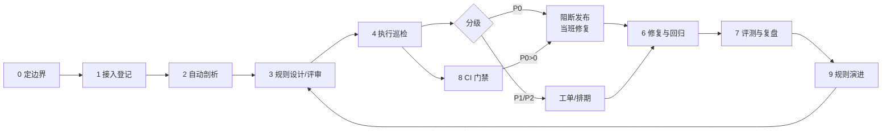

# dq-sentinel 工作流程（v0.1）

> 目标：把“数据质量巡检”从人工抽查，变成一条 **可重复、可度量、可门禁** 的流水线。
> 每条规则都能回答三个问题：防什么问题、违规影响什么、误报从哪来。

## 一、角色与职责

| 角色 | 职责 | 在本流程中的动作 |
| --- | --- | --- |
| 数据开发 | 表/任务/分区 | 接入登记、修复数据、重跑任务 |
| 数据质量 | 规则与口径 | 设计规则、评审误报、维护评测集 |
| 业务负责人 | 业务语义 | 确认枚举/空值是否允许、P0 定级 |
| Agent（本 skill） | 自动执行 | 剖析、跑规则、出报告、给修复建议 |

## 二、主流程（9 步）

| # | 环节 | 输入 | 动作 | 产出 | 频率 |
| --- | --- | --- | --- | --- | --- |
| 0 | 定边界 | 库/表清单、SLA | 确定范围、频率、P0 白名单 | 接入范围说明 | 项目启动 |
| 1 | 接入登记 | 表结构、负责人、产出时间 | 登记到 `rules.json`，标注严重级别 | 接入清单 | 新表上线 |
| 2 | 自动剖析 | 表数据（采样或全量） | 算行数、空值率、唯一率、枚举分布、日期范围 | profile 报告 + 候选规则 | 首次 + 每周 |
| 3 | 规则设计 | profile + 业务规则 + 历史事故 | 写 name/type/参数/severity/design_basis | `rules.json` 变更（PR 评审） | 首次 + 按需 |
| 4 | 执行巡检 | 规则 + 数据 | 跑规则，收集 rowid 级违规 | `latest.json` + `latest.md` | 每日 / 发布前 |
| 5 | 分级处置 | 巡检报告 | P0 阻断、P1 当天、P2 排期；误报打标 | 工单 / 阻断记录 | 每次巡检后 |
| 6 | 修复与回归 | 违规明细 + 修复建议 | 改数据或改规则，重跑 check | 修复记录（before/after） | 当班 |
| 7 | 评测与复盘 | ground truth 或抽样 | 算检出率/误报率；漏报归因 | 周报 + badcase 清单 | 每周 |
| 8 | CI 门禁 | 发布流水线 | P0>0 fail，P1 超阈值 warn | 流水线结果 | 每次发布 |
| 9 | 规则演进 | 误报 top3、新事故 | 调阈值/加白名单/新增规则；LLM 候选规则人工确认 | 规则版本 | 每月 |

## 三、流程图

## 四、分支处理

**误报（规则抓错了）**
1. 标记 `false_positive`，记录原因（业务允许空值 / 历史数据 / 维表变更）
2. 二选一：加白名单、调阈值、改表达式
3. 规则变更走 PR，附 before/after 误报数

**漏报（问题没抓到）**
1. 从事故复盘反推：是规则缺失、阈值太松，还是数据延迟？
2. 补规则时同步补 ground truth 样例，下次评测能回归

**数据延迟（及时性告警）**
1. 先看调度依赖与上游分区
2. 恢复后补跑，并在报告里标注“延迟已恢复”
3. 连续两次延迟 → 升级为 P1 并通知负责人

## 五、指标口径

| 指标 | 定义 | 用途 |
| --- | --- | --- |
| 规则覆盖率 | 有规则的关键字段 / 关键字段总数 | 衡量治理广度 |
| 检出率（Recall） | TP / (TP + FN) | 衡量抓得全不全 |
| 误报率 | FP / (TP + FP) | 衡量规则准不准 |
| MTTR | 从发现到修复的平均时长 | 衡量处置效率 |
| 门禁拦截次数 | CI 中因 P0 阻断的次数 | 衡量防线有效性 |

## 六、与目标岗位的对应

| JD 要求 | 本流程对应 |
| --- | --- |
| 智能湖仓、数据清洗 | 2 剖析 + 3 规则，入仓前体检 |
| 数据治理（及时性/准确性/一致性） | 5 分级 + 8 门禁，按维度定规则 |
| 营销/制造/供应链场景落地 | 1 接入 + 3 规则，按业务语义配置 |
| AI 建模 / 智能治理 | 9 演进，LLM 生成候选规则 |
| 沟通与推动 | 5 工单 + 7 周报，跨角色闭环 |

## 七、频率建议

- **每日**：全量巡检（T+1 数据）、报告推送
- **每次发布**：CI 门禁（P0 阻断）
- **每周**：评测 + 误报 top3 复盘
- **每月**：规则库评审、覆盖率盘点

## 八、实现状态

| 环节 | 状态 | 对应命令 / 文件 |
| --- | --- | --- |
| 0 定边界 | ✅ 文档 | 本文档 |
| 1 接入登记 | ✅ | `rules/rules.json` |
| 2 自动剖析 | ✅ | `dq.py profile` |
| 3 规则设计 | ✅ | `dq.py suggest`（候选）+ 人工评审 |
| 4 执行巡检 | ✅ | `dq.py check` |
| 5 分级处置 | ✅ | `check --fail-on P0`、`mark` 误报标注 |
| 6 修复与回归 | ✅ 半自动 | 修复后重跑 `check` |
| 7 评测与复盘 | ✅ | `dq.py evaluate` + 报告第四节 |
| 8 CI 门禁 | ✅ | `check --fail-on P0`、`.github/workflows/dq-gate.yml` |
| 9 规则演进 | ✅ 启发式 + LLM 接口 | `dq.py suggest [--llm]` |
